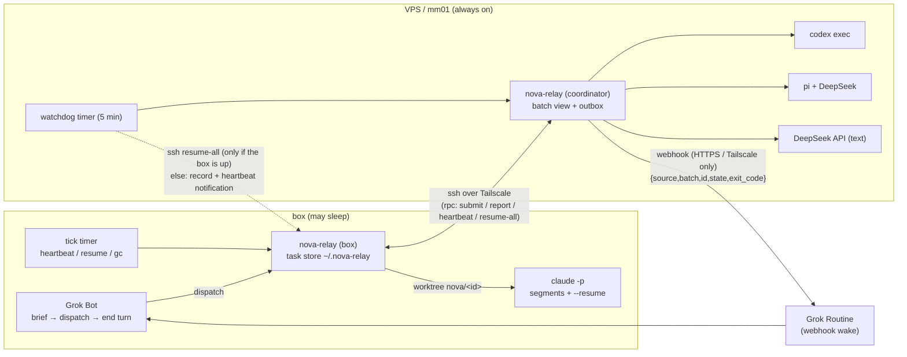

# nova-relay

**English** | [中文（主文档）](README.zh-CN.md)

nova-relay is a small, pluggable **planner → executor relay**:

- **Planner = Grok Bot** on a Linux "box" that may sleep when idle. Grok only writes a templated **task brief** (goal, files in scope, acceptance command, forbidden actions), dispatches it and **ends its turn**. It is woken once per finished batch, reads a one-line verdict, spot-checks, and `ack`s.
- **Executors** are adapters chosen by a routing rule (task type → executor) in config:
  | executor | implementation | runs on | for |
  |---|---|---|---|
  | `claude` | official Claude Code CLI `claude -p`, subscription login | **box only** | long tasks, 10–15 min segments resumed with `--resume` |
  | `codex` | official Codex CLI `codex exec`, ChatGPT subscription | always-on VPS / mm01 | regular code tasks |
  | `pi` | Pi coding agent (pi.dev) + DeepSeek API key | VPS / mm01 | multi-step code edits |
  | `deepseek-text` | plain DeepSeek API call | VPS / mm01 | text-only jobs (copy, translation, summaries), no shell |
- **The acceptance script is the only truth**: tests / typecheck / lint / diffstat, printing one line: `PASS` or `FAIL <where>`. An executor's self-reported success is ignored.

No third-party API gateways, no `--bare`, no long blocking waits in the planner's turn.

> Rewritten from GAP / grokbot-and-pi (MIT), itself based on robbin/grokbot-local-agent. See [NOTICE](NOTICE) and [LICENSE](LICENSE).

## Architecture



## Key properties

- **Disk is the source of truth**: `~/.nova-relay/tasks/<id>/` holds `brief.md`, `state.json` (atomic writes, rebuilt from `journal.jsonl` if corrupt), `events.jsonl`, `progress.md`, `result.md`. State files are schema-versioned with migrations.
- **Batch wakes only**: the webhook fires when the whole batch is terminal, when a task's segment fails more than 3 times, or when a task needs approval/auth/is blocked. Payload is exactly `{source,batch,id,state,exit_code}`; the dedup key travels in `Idempotency-Key`. Delivery goes through a durable outbox with backoff, oldest first; redirects are not followed (a 3xx stays queued), so a wake cannot be silently delivered elsewhere.
- **Segments**: wall-clock cap + idle timeout per segment; after each segment nova-relay commits a checkpoint on the task branch and stores the executor's PROGRESS summary; the next segment receives a progress summary, not the full history.
- **Local retry**: acceptance FAIL is fed back to the executor up to `max_local_retries` times before escalating.
- **Isolation**: one git worktree + branch `nova/<id>` per task, no concurrent tasks with overlapping file scopes in a project, separate repo/worktrees/env/webhook/owner per project (e.g. PD vs NM); cross-project paths are refused.
- **Guard** (`nova-guard`, formerly pi-guard): destructive deletes, any `git push`, remote/config changes, publishing, outbound network/messages, host config, credential reads, writes outside the worktree → blocked into the approval flow. Commands are split (`bash -lc`, `$(…)`, pipes), wrappers are parsed (`env -i`, `nice -n`, `timeout`, `xargs`, `sudo`, `eval`), directory changes are followed (`cd`, `git -C/--git-dir/--work-tree`, `make -C`, `npm --prefix`, `env -C`, `tar -C`; unresolvable targets are denied), write targets outside the worktree are denied (redirections, cp/mv/tee/rm/sed -i, symlinks resolved), code-injecting env assignments (`PATH` with executor-writable dirs, `LD_*`, `NODE_OPTIONS`, `GIT_*`) are blocked, and scripts the executor could have written (shell, npm scripts, Makefiles, heuristic scan of python/node/…) are inspected before they run. Claude uses a PreToolUse hook (verified live on Claude Code 2.1.308; a run where tools were used but the hook never fired is blocked, because `claude -p` silently ignores invalid `--settings`), Pi an extension (must report that it loaded; pi runs with `--no-extensions --no-approve --no-mcp`, so no other extension can rewrite a call after the guard approved it, and unknown tools are blocked). Codex has no pre-hook: its `workspace-write` sandbox (run with `--ignore-user-config --ignore-rules`, no `--trust`), plus an after-the-fact audit of every command, file change and MCP call in its `--json` event stream (hits become `audit` approvals; a run with no parseable events is blocked), plus acceptance-time checks.
- **Independent acceptance for every executor**: the executor's self-report is ignored. Leftover background jobs are killed, the segment is checkpointed, and the brief's commands + project checks run in a fresh, hook-less, detached checkout of the task branch commit in a standalone temporary clone (planted ignored/untracked files don't exist there; git commands run by setup or tests — e.g. husky's `git config core.hooksPath` — cannot touch the shared repo), with an allowlisted env, an empty HOME, a private TMPDIR, a PATH without relative or repo/worktree entries, and `bash --noprofile --norc`. Commands run asynchronously, so the worker keeps renewing its lease during a long `npm ci` + test run, and a cancel kills them. Tampering is fatal and never retried: shared `.git/config`/`hooks`/`info` changed, HEAD moved off `nova/<id>` or history rewritten, tests deleted/skipped/removed, test harness or `package.json` scripts or a script the acceptance command calls changed (unless the brief says `allow_harness_changes: true`), symlinks escaping the worktree or replacing test files, the shared `.git` or the task branch changed while the commands ran. A failing `acceptance_setup` (registry/network down) is `FAIL setup:…` and escalated, not handed back to the executor. Forbidden paths, scope, empty diff and command failures are retried locally with the error.
- **Model ids are explicit**: `pi` and `deepseek-text` have no default model; the config must name one (the example ships a placeholder that fails `config-check`). `doctor --live` requires the id to appear verbatim in DeepSeek's `GET /models`; a provider "model does not exist" error blocks the task. No other id is ever substituted.
- **Quota**: a paused executor's queued tasks are rerouted at dispatch; running tasks optionally reroute at the next segment boundary (`routing.reroute_paused`: same host in place, or across hosts with a git bundle of the task branch). Off by default.
- **Concurrency**: cross-process locks around every state/batch/budget update, one worker per host, journal with sequence numbers replayed after a crash, orphaned executor process groups killed on resume, and a "frozen" worker is only killed after 3×TTL of *observed* non-renewal (so a box waking from sleep is not mistaken for a hung worker).
- **Recovery = detection + notification + resume once the host runs again**: TTL leases; a stale lease is stolen under a lock with a re-check (two watchdogs can't double-resume). *Detection*: the VPS watchdog tries `ssh box … resume-all` every 5 minutes and records when the box became unreachable; the box's own timer finds dead/frozen workers. *Notification*: a missed box heartbeat sends one `box_unreachable` webhook per outage — that wakes the Grok routine, **not the machine**. *Resume*: only after the box is running again (its own timer or the next watchdog that reaches it), from the last checkpoint. ssh cannot wake or unfreeze a suspended host, and nothing in nova-relay does; tasks on a sleeping box wait.
- **Secrets** only from env vars or `~/.config/nova-relay/secrets.env` (must be 0600). Every name in `secrets.env`, every env name the config declares as a secret (webhook `url_env`/`key_env`, executor `key_env`) and secret-looking names (`*_KEY`, `*_TOKEN`, …) are withheld from executor and acceptance processes whatever they are called, and their values are redacted from logs/results (pi receives its own `key_env` explicitly). This is env hygiene, not a sandbox: code running as the same user can still read files by absolute path (see docs/security.md).

> ⚠️ **Recovery must be verified in a real test.** Sleep/reboot/Tailscale-loss handling is covered by unit and integration tests, but real machines (systemd timers, ssh, CLI versions) must be tested in place. nova-relay does **not** guarantee uptime or zero downtime and cannot wake a sleeping box. What it is designed to provide: state on disk, detection and one notification per outage, resume from the last checkpoint once the host runs again (its own timer or the watchdog has to run), bounded retries/limits instead of infinite loops, and every stop recorded as a task state rather than silently dropped. These are design goals checked by local tests, not guarantees against disk loss, a host that never comes back, or untested real-machine behaviour.

## Quick start

```bash
./install.sh --systemd box        # on the box; on the VPS: --systemd vps
$EDITOR ~/.config/nova-relay/config.json   # docs/config.md
nova-relay doctor              # add --live for real login/key checks (opt-in)
nova-relay brief-template > /tmp/t1.md
nova-relay dispatch --project PD /tmp/t1.md
# … webhook wake …
nova-relay pending --owner grok-pd
nova-relay ack <batch> --owner grok-pd
```

## Docs (Chinese)

[setup-box](docs/setup-box.md) · [setup-vps](docs/setup-vps.md) · [config](docs/config.md) · [failure-modes](docs/failure-modes.md) · [security](docs/security.md) · [cli](docs/cli.md) · [Grok routine prompt](routines/grok-wake.md) · [skills](skills/) · [AGENTS.md](AGENTS.md)

## Development

```bash
npm test   # node --test, zero dependencies, Node >= 22
```

## License

MIT, upstream copyright lines retained — see [LICENSE](LICENSE) and [NOTICE](NOTICE).
