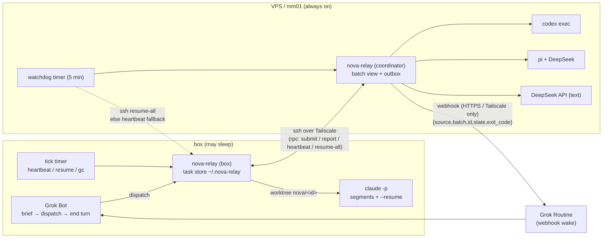

# nova-relay

**English** | [中文（主文档）](README.zh-CN.md)

nova-relay is a small, pluggable **planner → executor relay**:

- **Planner = Grok Bot** on a Linux "box" that may sleep when idle. Grok only writes a templated **task brief** (goal, files in scope, acceptance command, forbidden actions), dispatches it and **ends its turn**. It is woken once per finished batch, reads a one-line verdict, spot-checks, and `ack`s.
- **Executors** are adapters chosen by a routing rule (task type → executor) in config:
  | executor | implementation | runs on | for |
  |---|---|---|---|
  | `claude` | official Claude Code CLI `claude -p`, subscription login | **box only** | long tasks, 10–15 min segments resumed with `--resume` |
  | `codex` | official Codex CLI `codex exec`, ChatGPT subscription | always-on VPS / mm01 | regular code tasks |
  | `pi` | Pi coding agent (pi.dev) + DeepSeek API key | VPS / mm01 | multi-step code edits |
  | `deepseek-text` | plain DeepSeek API call | VPS / mm01 | text-only jobs (copy, translation, summaries), no shell |
- **The acceptance script is the only truth**: tests / typecheck / lint / diffstat, printing one line: `PASS` or `FAIL <where>`. An executor's self-reported success is ignored.

No third-party API gateways, no `--bare`, no long blocking waits in the planner's turn.

> Rewritten from GAP / grokbot-and-pi (MIT), itself based on robbin/grokbot-local-agent. See [NOTICE](NOTICE) and [LICENSE](LICENSE).

## Architecture



## Key properties

- **Disk is the source of truth**: `~/.nova-relay/tasks/<id>/` holds `brief.md`, `state.json` (atomic writes, rebuilt from `journal.jsonl` if corrupt), `events.jsonl`, `progress.md`, `result.md`. State files are schema-versioned with migrations.
- **Batch wakes only**: the webhook fires when the whole batch is terminal, when a task's segment fails more than 3 times, or when a task needs approval/auth/is blocked. Payload is exactly `{source,batch,id,state,exit_code}`; the dedup key travels in `Idempotency-Key`. Delivery goes through a durable outbox with backoff.
- **Segments**: wall-clock cap + idle timeout per segment; after each segment nova-relay commits a checkpoint on the task branch and stores the executor's PROGRESS summary; the next segment receives a progress summary, not the full history.
- **Local retry**: acceptance FAIL is fed back to the executor up to `max_local_retries` times before escalating.
- **Isolation**: one git worktree + branch `nova/<id>` per task, no concurrent tasks with overlapping file scopes in a project, separate repo/worktrees/env/webhook/owner per project (e.g. PD vs NM); cross-project paths are refused.
- **Guard** (`nova-guard`, formerly pi-guard): destructive deletes, any `git push`, remote/config changes, publishing, outbound network/messages, host config, credential reads, writes outside the worktree → blocked into the approval flow. Commands are split (`bash -lc`, `$(…)`, pipes), write targets outside the worktree are denied (redirections, cp/mv/tee/rm/sed -i, symlinks resolved), and scripts the executor could have written (shell, npm scripts, Makefiles, heuristic scan of python/node/…) are inspected before they run. Claude uses a PreToolUse hook (verified live on Claude Code 2.1.308; a run where tools were used but the hook never fired is blocked, because `claude -p` silently ignores invalid `--settings`), Pi an extension (must report that it loaded). Codex has no pre-hook: its `workspace-write` sandbox, plus an after-the-fact audit of every command in its `--json` event stream (hits become `audit` approvals), plus acceptance-time checks.
- **Acceptance-time checks for every executor**: shared `.git/config` / `.git/hooks` unchanged (else `FAIL integrity`, not retried), no symlinks escaping the worktree, forbidden paths, scope, test deletion/skips, empty diff, then the brief's commands and the project's checks.
- **Quota**: a paused executor's queued tasks are rerouted at dispatch; running tasks optionally reroute at the next segment boundary (`routing.reroute_paused`: same host in place, or across hosts with a git bundle of the task branch). Off by default.
- **Concurrency**: cross-process locks around every state/batch/budget update, one worker per host, journal with sequence numbers replayed after a crash, orphaned executor process groups killed on resume, and a "frozen" worker is only killed after 3×TTL of *observed* non-renewal (so a box waking from sleep is not mistaken for a hung worker).
- **Recovery**: TTL leases with atomic stealing (two watchdogs can't double-resume); the VPS watchdog asks the box to resume over Tailscale ssh every 5 minutes; if the box is unreachable, a missed box heartbeat triggers one webhook so Grok resumes.
- **Secrets** only from env vars or `~/.config/nova-relay/secrets.env` (must be 0600), redacted from logs/results, never passed to executor processes.

> ⚠️ **Recovery must be verified in a real test.** Sleep/reboot/Tailscale-loss handling is covered by unit and integration tests, but real machines (systemd timers, ssh, CLI versions) must be tested in place. nova-relay does **not** guarantee uptime; it guarantees state on disk, no silent loss and no infinite loops.

## Quick start

```bash
./install.sh --systemd box        # on the box; on the VPS: --systemd vps
$EDITOR ~/.config/nova-relay/config.json   # docs/config.md
nova-relay doctor              # add --live for real login/key checks (opt-in)
nova-relay brief-template > /tmp/t1.md
nova-relay dispatch --project PD /tmp/t1.md
# … webhook wake …
nova-relay pending --owner grok-pd
nova-relay ack <batch> --owner grok-pd
```

## Docs (Chinese)

[setup-box](docs/setup-box.md) · [setup-vps](docs/setup-vps.md) · [config](docs/config.md) · [failure-modes](docs/failure-modes.md) · [security](docs/security.md) · [cli](docs/cli.md) · [Grok routine prompt](routines/grok-wake.md) · [skills](skills/) · [AGENTS.md](AGENTS.md)

## Development

```bash
npm test   # node --test, zero dependencies, Node >= 22
```

## License

MIT, upstream copyright lines retained — see [LICENSE](LICENSE) and [NOTICE](NOTICE).
