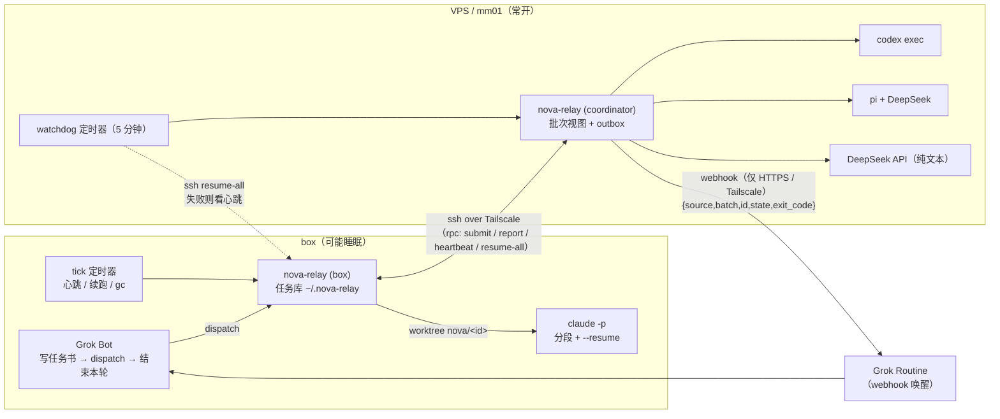
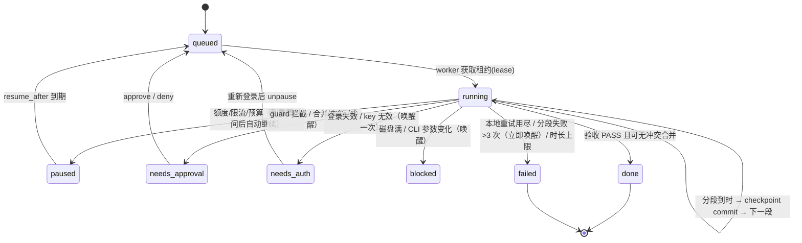

# nova-relay

[English](README.md) | **中文（主文档）**

nova-relay 是一个小而可插拔的「规划者 → 执行者」中继：

- **规划者（Planner）= Grok Bot**，跑在一台空闲时可能睡眠的 Linux「box」上。Grok 只负责写一份模板化的**任务书**（目标、文件范围、验收命令、禁止事项），派发后**立即结束本轮**；每个批次（batch）结束时只被唤醒一次，读一行结论（verdict），抽查，然后 `ack`。
- **执行者（Executor）** 是可插拔的适配器，由配置里的路由规则按任务类型选择：
  | 执行者 | 实现 | 运行位置 | 用途 |
  |---|---|---|---|
  | `claude` | 官方 Claude Code CLI `claude -p`，订阅登录 | **只在 box** | 长任务；按 10–15 分钟分段，`--resume` 续跑 |
  | `codex` | 官方 Codex CLI `codex exec`，ChatGPT 订阅登录 | 常开 VPS / mm01 | 常规代码任务 |
  | `pi` | Pi coding agent（pi.dev）+ DeepSeek API key | VPS / mm01 | 多步代码修改 |
  | `deepseek-text` | 直接调用 DeepSeek API | VPS / mm01 | 纯文本（文案、翻译、摘要），无 shell |
- **验收脚本是唯一的真相**：跑测试/类型检查/lint/diffstat，只输出一行 `PASS` 或 `FAIL <位置>`。执行者自己说"完成了"一律不算。

> 本项目改写自 GAP / grokbot-and-pi（MIT），后者基于 robbin/grokbot-local-agent。见 [NOTICE](NOTICE) 与 [LICENSE](LICENSE)。

## 架构



一个任务的生命周期：



## 关键设计

| 主题 | 做法 |
|---|---|
| 真相来源 | 磁盘任务库 `~/.nova-relay/tasks/<id>/`：`brief.md`、`state.json`、`journal.jsonl`、`events.jsonl`、`progress.md`、`result.md`。原子写（tmp+rename）；`state.json` 损坏时用 journal 重放。 |
| 批次与唤醒 | webhook **只在**：整个批次结束；某任务分段失败 >3 次；需要审批 / 需要登录 / 被阻塞。payload 只有 `{source,batch,id,state,exit_code}`，不含任务内容和密钥。去重键放在 `Idempotency-Key` 头。 |
| 分段 | 每段有墙钟上限（默认 12 分钟）和空闲超时；每段结束后由 nova-relay 在任务分支上 `git commit` 检查点，并把执行者的 PROGRESS 摘要写入 `progress.md`；下一段带「进度摘要」而非完整历史。 |
| 本地重试 | 验收 FAIL 时把错误本身交给执行者重试，最多 `max_local_retries` 次再上报。 |
| 隔离 | 每个任务一个 git worktree + 分支 `nova/<id>`；同项目文件范围重叠的任务不并发；PD / NM 等项目用各自的 repo、worktree 目录、env 文件、webhook、owner，路由拒绝跨项目路径。 |
| 守卫 | `nova-guard`（原 pi-guard）：灾难删除、任何 `git push`、改 remote、发包、外发网络/消息、改主机配置、读凭据、写出 worktree / 禁止路径 → 拦截并进入审批流程。Claude 用 PreToolUse hook，Pi 用扩展；Codex 依赖其 `workspace-write` 沙箱 + 验收阶段检查。 |
| 恢复 | 租约（lease）带 TTL，抢占是原子的，所以两个 watchdog 不会重复续跑；VPS watchdog 每 5 分钟经 Tailscale ssh 让 box 续跑；连不上 box 时看 box 推送的心跳，超时就发 webhook 让 Grok 醒来处理。 |
| 密钥 | 只来自环境变量或仓库外的 `~/.config/nova-relay/secrets.env`（必须 0600）；日志/结果统一脱敏；执行者子进程拿不到 webhook 密钥。 |

> ⚠️ **恢复能力必须在真实环境中验证。** 睡眠、重启、Tailscale 断线下的续跑逻辑有单元/集成测试覆盖，但真实机器上的行为（systemd 定时器、ssh、CLI 版本）只能实测确认。nova-relay **不保证**可用性，只保证：状态在磁盘上、不会静默丢失、不会无限循环。

## 快速开始

```bash
git clone <this repo> nova-relay && cd nova-relay
./install.sh --systemd box     # 在 box 上；VPS 上用 --systemd vps
$EDITOR ~/.config/nova-relay/config.json   # 参考 docs/config.md
nova-relay doctor
```

Grok 派活（典型一轮）：

```bash
nova-relay brief-template > /tmp/t1.md      # 填写任务书
nova-relay dispatch --project PD /tmp/t1.md /tmp/t2.md
# 输出 batch b-2026...，Grok 告诉用户已派发并结束本轮
```

Grok 被 webhook 唤醒后：

```bash
nova-relay pending --owner grok-pd          # 一行一个批次：batch b-… PASS 2/2
nova-relay batch b-…                        # 每个任务的结论与分支
git -C ~/work/pd diff main...nova/t-…       # 抽查
nova-relay ack b-… --owner grok-pd
```

## 文档

- [docs/setup-box.md](docs/setup-box.md) — box（Grok + Claude Code）安装
- [docs/setup-vps.md](docs/setup-vps.md) — VPS / mm01（coordinator + codex/pi/deepseek + watchdog）安装
- [docs/config.md](docs/config.md) — 配置参考
- [docs/failure-modes.md](docs/failure-modes.md) — 故障模式表：问题 / 检测 / 自动处理 / 何时唤醒 Grok
- [docs/security.md](docs/security.md) — 守卫、审批、密钥与提示词注入
- [docs/cli.md](docs/cli.md) — 命令参考
- [routines/grok-wake.md](routines/grok-wake.md) — Grok webhook 唤醒 Routine 提示词模板
- [skills/](skills/) — Grok 技能：`nova-relay-dispatch`、`nova-relay-setup`
- [AGENTS.md](AGENTS.md) — 给 AI Agent 的配置步骤

## 开发

```bash
npm test     # node --test，无第三方依赖，Node >= 22
```

代码结构：`lib/executors/*.mjs`（每个执行者一个文件，新增执行者 = 加一个文件 + 注册一行）、`lib/runner.mjs`（分段循环）、`lib/relay.mjs`（批次/worker/续跑/tick/gc）、`lib/acceptance.mjs`、`lib/guard.mjs`、`lib/notify.mjs`（唤醒规则 + outbox）、`lib/doctor.mjs`。

## 许可

MIT。保留上游版权声明，见 [LICENSE](LICENSE) 与 [NOTICE](NOTICE)。
