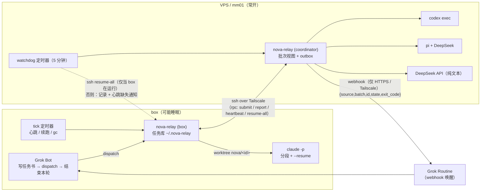
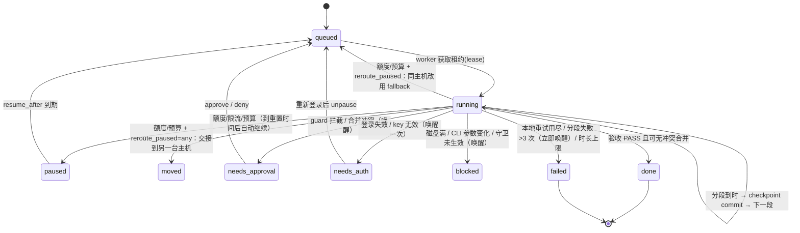

# nova-relay

[English](README.md) | **中文（主文档）**

nova-relay 是一个小而可插拔的「规划者 → 执行者」中继：

- **规划者（Planner）= Grok Bot**，跑在一台空闲时可能睡眠的 Linux「box」上。Grok 只负责写一份模板化的**任务书**（目标、文件范围、验收命令、禁止事项），派发后**立即结束本轮**；每个批次（batch）结束时只被唤醒一次，读一行结论（verdict），抽查，然后 `ack`。
- **执行者（Executor）** 是可插拔的适配器，由配置里的路由规则按任务类型选择：
  | 执行者 | 实现 | 运行位置 | 用途 |
  |---|---|---|---|
  | `claude` | 官方 Claude Code CLI `claude -p`，订阅登录 | **只在 box** | 长任务；按 10–15 分钟分段，`--resume` 续跑 |
  | `codex` | 官方 Codex CLI `codex exec`，ChatGPT 订阅登录 | 常开 VPS / mm01 | 常规代码任务 |
  | `pi` | Pi coding agent（pi.dev）+ DeepSeek API key | VPS / mm01 | 多步代码修改 |
  | `deepseek-text` | 直接调用 DeepSeek API | VPS / mm01 | 纯文本（文案、翻译、摘要），无 shell |
- **验收脚本是唯一的真相**：跑测试/类型检查/lint/diffstat，只输出一行 `PASS` 或 `FAIL <位置>`。执行者自己说"完成了"一律不算。

> 本项目改写自 GAP / grokbot-and-pi（MIT），后者基于 robbin/grokbot-local-agent。见 [NOTICE](NOTICE) 与 [LICENSE](LICENSE)。

## 架构



一个任务的生命周期：



## 关键设计

| 主题 | 做法 |
|---|---|
| 真相来源 | 磁盘任务库 `~/.nova-relay/tasks/<id>/`：`brief.md`、`state.json`、`journal.jsonl`、`events.jsonl`、`progress.md`、`result.md`。原子写（tmp+rename）；`state.json` 损坏时用 journal 重放。 |
| 批次与唤醒 | webhook **只在**：整个批次结束；某任务分段失败 >3 次；需要审批 / 需要登录 / 被阻塞。payload 只有 `{source,batch,id,state,exit_code}`，不含任务内容和密钥。去重键放在 `Idempotency-Key` 头。经持久化 outbox 按入队顺序发送、失败退避重试；不跟随重定向（3xx 留在 outbox），唤醒不会被悄悄送到别处。 |
| 分段 | 每段有墙钟上限（默认 12 分钟）和空闲超时；每段结束后由 nova-relay 在任务分支上 `git commit` 检查点，并把执行者的 PROGRESS 摘要写入 `progress.md`；下一段带「进度摘要」而非完整历史。 |
| 本地重试 | 验收 FAIL 时把错误本身交给执行者重试，最多 `max_local_retries` 次再上报。 |
| 隔离 | 每个任务一个 git worktree + 分支 `nova/<id>`；同项目文件范围重叠的任务不并发；PD / NM 等项目用各自的 repo、worktree 目录、env 文件、webhook、owner，路由拒绝跨项目路径。 |
| 守卫 | `nova-guard`（原 pi-guard）：灾难删除、任何 `git push`、改 remote / git alias / hooksPath、发包、外发网络/消息、改主机配置、读凭据、写出 worktree / 禁止路径（含重定向、cp/mv/tee/rm/sed -i，符号链接解析后判断，目标无法解析默认拒绝；跟踪换目录：`cd`、`git -C/--git-dir/--work-tree`、`make -C`、`npm --prefix`、`env -C`、`tar -C`，目录解析不了默认拒绝；先解析 `env -i`、`nice -n`、`timeout`、`xargs`、`sudo`、`eval` 等包装命令的参数）、注入代码的环境变量（`PATH` 含执行者可写目录、`LD_*`、`NODE_OPTIONS`、`GIT_*`）、执行者可能写的脚本（shell、npm scripts、Makefile、python/node 等启发式扫描）→ 拦截并进入审批流程。Claude 用 PreToolUse hook（已在 Claude Code 2.1.308 实测；有工具调用但 hook 没被调用 = 守卫失效 → blocked），Pi 用扩展（加载时写标记；pi 以 `--no-extensions --no-approve --no-mcp` 运行，别的扩展无法在守卫放行后改写命令，未知工具一律拦截；已用 pi 1.5.2 实测）；Codex 没有前置 hook：`workspace-write` 沙箱（`--ignore-user-config --ignore-rules`，不加 `--trust`）+ 对 `--json` 事件中每条命令、文件改动、MCP 调用的事后审计（命中 → audit 审批；没有可解析事件 → blocked）+ 验收阶段检查。 |
| 验收独立检查 | 执行者自述一律不作数。分段结束先杀残留后台进程、checkpoint 提交；任务书命令与项目 checks 在任务分支提交的**全新干净检出**（独立的临时 clone，detached、无 hook）里运行，执行者留下的未跟踪/被忽略文件不存在，setup/测试里的 git 命令（如 husky 的 `git config core.hooksPath`）改不到共享仓库；环境只有白名单变量 + 空 HOME + 私有 TMPDIR + 去掉相对/仓库内条目的 PATH + `bash --noprofile --norc`；命令异步运行，worker 期间照常续租，取消会杀掉验收命令。篡改**致命且不重试**：共享 `.git/config`/`hooks`/`info` 被改、HEAD 离开 `nova/<id>` 或历史被改写、删除/跳过/减少测试、改测试框架或验收命令引用的脚本或 `package.json` 的 scripts（任务书 `allow_harness_changes: true` 可放开）、越界或替换测试文件的符号链接、验收命令运行期间共享 `.git` 或任务分支被改。`acceptance_setup` 失败（registry/网络不通）→ `FAIL setup:…` 并升级，不交给执行者重试。禁止路径、范围、空 diff、命令失败带错误本地重试。 |
| 模型名 | pi 与 deepseek-text **没有默认模型**，必须在配置里显式填写（示例配置是占位符，不改无法通过 `config-check`）；`doctor --live` 要求该 id 原样出现在 DeepSeek `GET /models` 里（列表读不到也算失败）；运行中供应商返回"模型不存在"→ 任务 `blocked`。绝不替换成别的 id。 |
| 额度改路由 | 派发时主执行者暂停 → fallback；运行中的任务可按 `routing.reroute_paused` 在分段边界改路由（同主机原地切换，或跨主机用 git bundle 交接分支），默认关闭。 |
| 并发 | 状态/批次/预算的读-改-写都在跨进程文件锁内（抢占死掉的持有者的锁必须先拿到该锁实例专属的抢占令牌并重新确认，视图过时的抢占者不会挪走活着的持有者的锁；持有者活着却在毫秒级临界区里停住 >120 s 仍会被当作已死——超时锁固有的窗口）；每台主机一个 worker；journal 带序号，崩溃后重放；续跑时先杀孤儿执行者进程组；`frozen` 只有在连续观察 3×TTL 仍不续租时才被杀（box 刚睡醒不会被误杀）。 |
| 恢复 | 分三件事：**检测**、**通知**、**主机恢复运行后续跑**。租约（lease）带 TTL，抢占在文件锁内重新检查后进行，两个 watchdog 不会重复续跑。检测：VPS watchdog 每 5 分钟尝试 `ssh box … resume-all`，连不上就记录 `unreachable_since`；box 运行时自己的定时器发现死掉/冻结的 worker。通知：box 心跳超时 → 每次中断发一次 `box_unreachable` webhook，它只唤醒 Grok 的 Routine，**不会唤醒机器**。续跑：只有 box 重新运行后（它自己的定时器或下一次连上它的 watchdog），才从最后一个 checkpoint 继续。ssh 不能唤醒或解冻挂起的主机，nova-relay 的任何部分都做不到；box 睡着时它上面的任务只能等待。 |
| 派发送达 | 任务提交前先以 `submitting` 登记到批次。提交超时或回复丢失时不猜结果：让执行主机对每个 id 做 fence——已存在就报告真实状态，不存在就写墓碑（之后迟到/重试的提交被拒），只有这种才判 `FAIL submit`。主机连不上时批次保持 WAIT，coordinator 的 tick 继续对账。看到 `submit error:` 不要重新 dispatch。 |
| 密钥 | 只来自环境变量或仓库外的 `~/.config/nova-relay/secrets.env`（必须 0600）。`secrets.env` 里的每个变量名、配置声明的密钥变量名（webhook `url_env`/`key_env`、执行者 `key_env`）以及像密钥的名字（`*_KEY`、`*_TOKEN`…），不论叫什么都不传给执行者与验收命令，值在日志/结果里脱敏（pi 显式拿到它自己的 `key_env`）。这是环境变量层面的隔离，不是沙箱：同一用户下的代码仍能按绝对路径读文件（见 docs/security.md）。 |

> ⚠️ **恢复能力必须在真实环境中验证。** 睡眠、重启、Tailscale 断线下的续跑逻辑有单元/集成测试覆盖，但真实机器上的行为（systemd 定时器、ssh、CLI 版本）只能实测确认。nova-relay **不保证**可用性、不保证零停机，也不能唤醒睡眠中的 box。它的设计目标是：状态在磁盘上、能检测并每次中断通知一次、主机重新运行后（需要它自己的定时器或 watchdog 跑起来）从 checkpoint 续跑、重试与时长都有上限而不是无限循环、每次停止都记录为任务状态而不是悄悄丢掉。这些是经本地测试检查的设计目标，不是保证——磁盘损坏、主机再也回不来、未实测的真实机器行为都不在其内。

## 快速开始

```bash
git clone <this repo> nova-relay && cd nova-relay
./install.sh --systemd box     # 在 box 上；VPS 上用 --systemd vps
$EDITOR ~/.config/nova-relay/config.json   # 参考 docs/config.md
nova-relay doctor          # 加 --live 做真实登录/key 检查（可选）
```

Grok 派活（典型一轮）：

```bash
nova-relay brief-template > /tmp/t1.md      # 填写任务书
nova-relay dispatch --project PD /tmp/t1.md /tmp/t2.md
# 输出 batch b-2026...，Grok 告诉用户已派发并结束本轮
```

Grok 被 webhook 唤醒后：

```bash
nova-relay pending --owner grok-pd          # 一行一个批次：batch b-… PASS 2/2
nova-relay batch b-…                        # 每个任务的结论与分支
git -C ~/work/pd diff main...nova/t-…       # 抽查
nova-relay ack b-… --owner grok-pd
```

## 文档

- [docs/setup-box.md](docs/setup-box.md) — box（Grok + Claude Code）安装
- [docs/setup-vps.md](docs/setup-vps.md) — VPS / mm01（coordinator + codex/pi/deepseek + watchdog）安装
- [docs/config.md](docs/config.md) — 配置参考
- [docs/failure-modes.md](docs/failure-modes.md) — 故障模式表：问题 / 检测 / 自动处理 / 何时唤醒 Grok
- [docs/security.md](docs/security.md) — 守卫、审批、密钥与提示词注入
- [docs/cli.md](docs/cli.md) — 命令参考
- [routines/grok-wake.md](routines/grok-wake.md) — Grok webhook 唤醒 Routine 提示词模板
- [skills/](skills/) — Grok 技能：`nova-relay-dispatch`、`nova-relay-setup`
- [AGENTS.md](AGENTS.md) — 给 AI Agent 的配置步骤

## 开发

```bash
npm test     # node --test，无第三方依赖，Node >= 22
```

代码结构：`lib/executors/*.mjs`（每个执行者一个文件，新增执行者 = 加一个文件 + 注册一行）、`lib/runner.mjs`（分段循环）、`lib/relay.mjs`（批次/worker/续跑/tick/gc）、`lib/acceptance.mjs`、`lib/guard.mjs`、`lib/notify.mjs`（唤醒规则 + outbox）、`lib/doctor.mjs`。

## 许可

MIT。保留上游版权声明，见 [LICENSE](LICENSE) 与 [NOTICE](NOTICE)。
